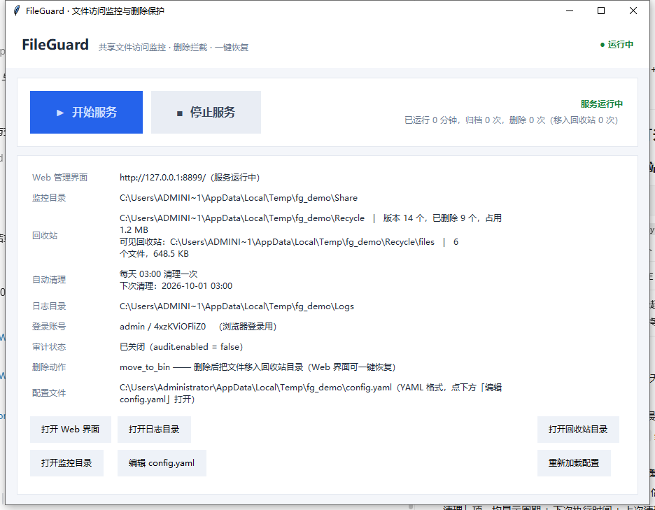
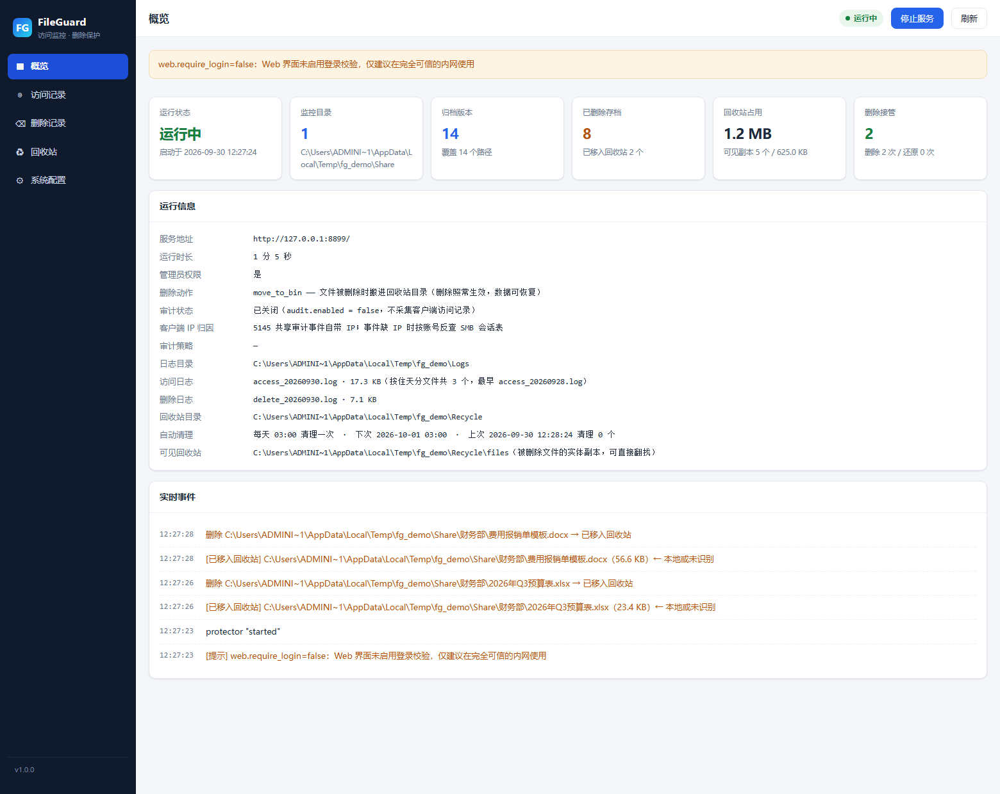
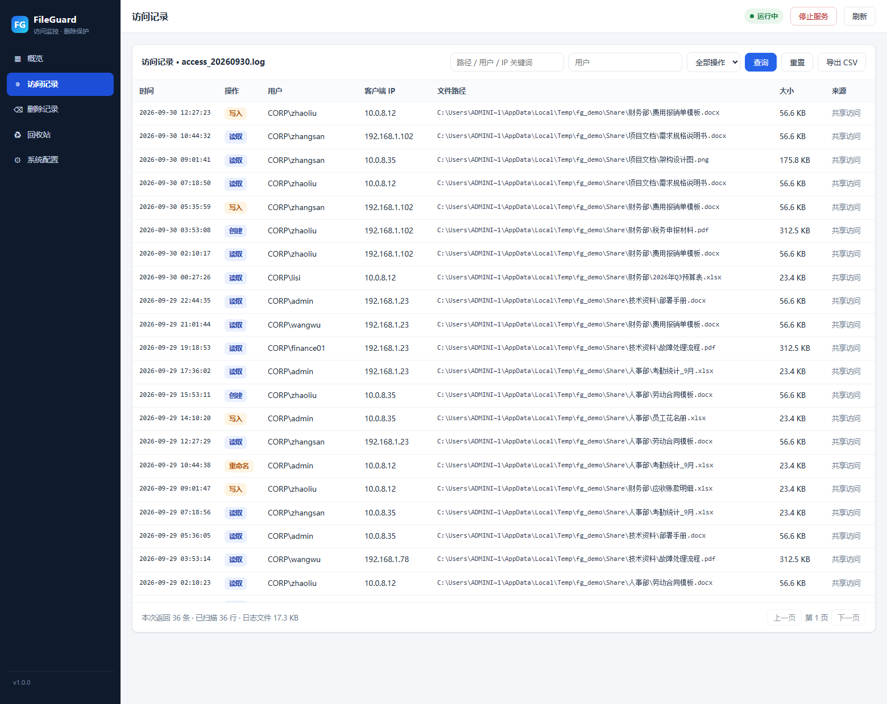
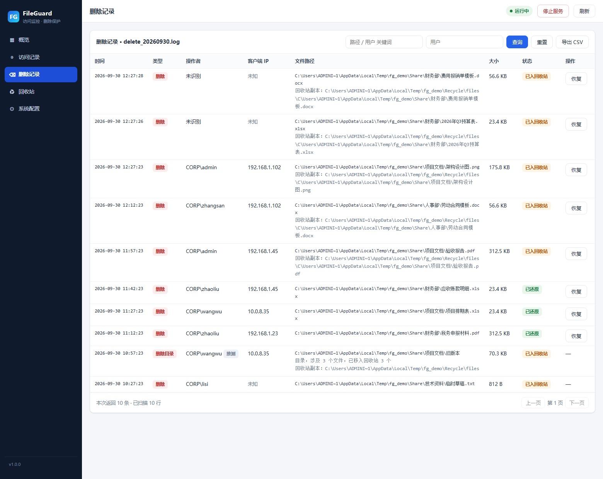
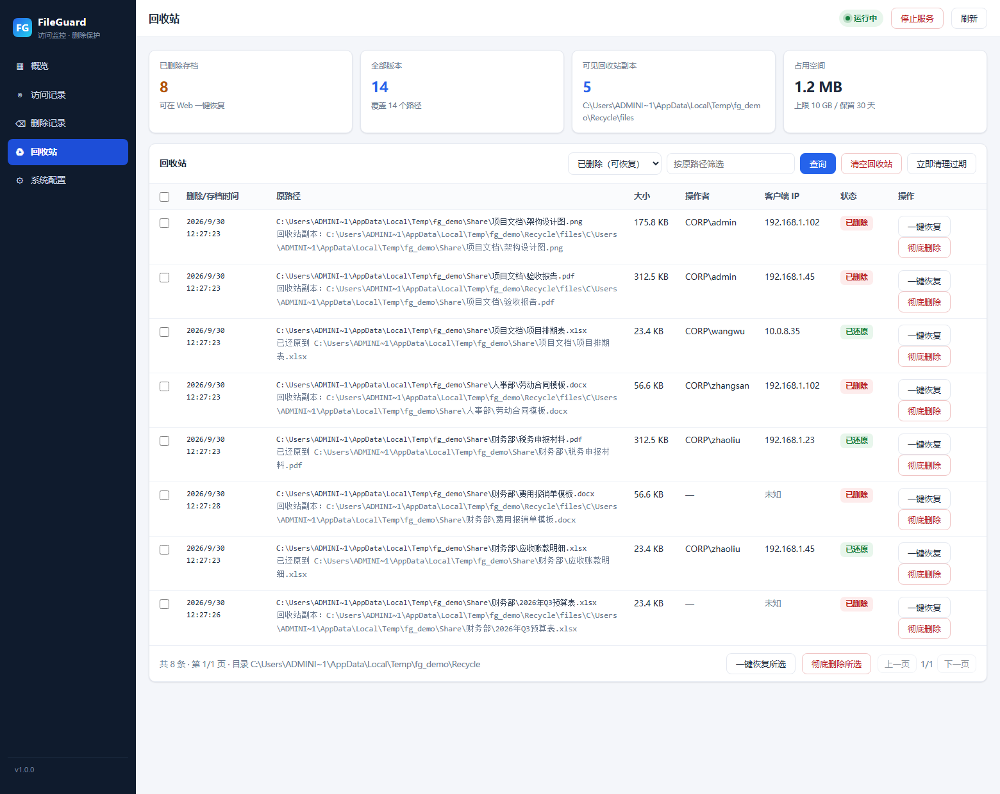

# FileGuard · 共享文件访问监控与删除保护

面向 Windows Server 共享文件夹的**访问审计 + 删除拦截 + 一键恢复**工具。
纯 Python 实现，单文件 exe 交付，自带图形控制台与 Web 管理界面。

```
┌──────────────────────── FileGuard.exe (管理员权限) ────────────────────────┐
│  ● 运行中                    [ ▶ 开始服务 ]  [ ■ 停止服务 ]                │
├───────────────────────────────────────────────────────────────────────────┤
│  Web 管理界面   http://127.0.0.1:8765/     登录 admin / ****              │
│  监控目录       D:\Share                                                  │
│  回收站         D:\FileGuardRecycle   版本 128 个，已删除 6 个，占用 2.1GB │
│  日志目录       D:\FileGuardLogs       access_20260930.log 等按天分文件  │
│  审计状态       正常，已采集 1,284 条安全事件                              │
└───────────────────────────────────────────────────────────────────────────┘
```

---

## 一、它能做什么

| 能力 | 说明 |
|---|---|
| **访问记录** | 记录**哪个客户端 IP、哪个账号**访问了共享里的哪个文件、做了读/写/删除操作，写入当天文件 `access_20260930.log` |
| **删除记录** | 记录每一次删除（含操作者、**来源 IP**、文件大小与内容指纹），写入当天文件 `delete_20260930.log` |
| **删除即入回收站** | 客户端删除文件后，删除**正常生效**（原文件消失），但内容由服务**移入回收站目录**，可在 Web 界面一键找回——不是物理消失 |
| **回收站 + 一键恢复** | 回收站既保留内容寻址的历史版本，也维护一份**保留原目录结构**的可见副本目录 `files/`，Web 界面按路径/时间筛选，支持单条恢复、批量恢复、彻底删除、清空 |
| **回收站可配置** | 存储位置、保留天数、容量上限、每文件保留版本数、自动清理周期、恢复后是否收回副本全部可配 |
| **关闭窗口服务不中断** | 关闭程序窗口只是**隐藏到系统托盘**，后台服务继续运行；托盘菜单「退出界面」同样只关界面。**只有点「停止服务」按钮才会真正关闭服务** |
| **Web 管理界面** | 概览 / 访问记录 / 删除记录 / 回收站 / 在线编辑 config.yaml，内置登录鉴权 |
| **配置文件即文档** | 所有配置项保存在 exe 同目录的 `config.yaml`，**每一项上方都有注释**说明用途、取值范围与默认值 |
| **旧配置自动迁移** | 升级时若检测到旧的 `config.json`，会自动转成 `config.yaml`（旧文件保留为 `.migrated` 备份）；`protection.auto_restore_on_delete` 等旧键会自动升级为 `on_delete_action` |

### 界面预览

| 程序主界面（开始/停止按钮） | Web · 概览 |
|---|---|
|  |  |

| Web · 访问记录 | Web · 删除记录 | Web · 回收站 |
|---|---|---|
|  |  |  |

> 截图取自 `tools/make_demo.py` 生成的演示环境（模拟一台被多台客户机访问的公司共享盘）。
> 演示环境为免提权关闭了 Windows 安全审计（`audit.enabled = false`），因此**由演示脚本在服务器本机触发的几次删除**
> 归因不到客户端 IP（界面显示「未知」，悬停有原因说明）；其余记录均为模拟的真实客户端访问，带账号与 IP。
> 真实部署（管理员 + 审计开启）下，网络客户端的删除同样能归因到客户端 IP。

---

## 二、快速开始

### 方式 A：使用打包好的 exe（推荐）

1. 把 `FileGuard.exe` 放到服务器任意目录（建议 `D:\FileGuard\`）。
2. 双击运行 → 弹出 UAC 提权 → 确认（**必须管理员权限**，否则审计功能不可用）。
3. 首次运行自动生成 `config.yaml`（**每一项都带中文注释**，说明用途 / 取值范围 / 默认值），并自动探测一个可用的共享目录作为默认监控路径。
4. 点击 **「编辑 config.yaml」**（会用记事本打开）把 `monitor.paths` 改成你的共享目录，例如写 `- D:\Share`，保存。
5. 回到主界面点 **「重新加载配置」** → 点 **「开始服务」**。
6. 点 **「打开 Web 界面」**，用界面上显示的 `admin / 密码` 登录。

> 首次启动会对大目录做**初始镜像**（把现有文件存入回收站作为基线），目录很大时需要几分钟，进度会显示在运行日志里。

> **放心的关闭方式**：点窗口右上角 **×** 只会把界面缩到系统托盘（会有气泡提示），服务照常在后台跑；
> 日常运维可以关掉窗口、让服务在托盘里长期驻留。要停服务请点 **「停止服务」** 按钮。

### 方式 B：源码运行（开发/调试）

```bash
pip install -r requirements.txt
python run.py
```

### 命令行模式（运维/排障用）

exe 是图形界面程序、没有控制台，因此额外提供了三种命令行模式，方便确认部署是否正确：

```bat
FileGuard.exe            图形界面（默认，双击即可）
FileGuard.exe --check    环境体检：管理员权限 / 依赖 / 安全日志 / auditpol / 目录与端口
                         结果输出到终端与 FileGuard.check.json
FileGuard.exe --selftest 打包后自检：在临时环境跑通「存档→删除→自动还原→日志→Web API」
                         结果输出到终端与 FileGuard.selftest.json
FileGuard.exe --nogui    无界面前台运行服务（Ctrl+C 停止），适合放进计划任务
```

> 命令行模式会尝试挂回调用它的控制台，因此在 cmd / PowerShell 里能直接看到输出。
> 自动化调用时可加 `--nopopup` 跳过结束时的弹窗。

### 演示环境

```bash
python tools/make_demo.py          # 造一批模拟的共享文件、访问/删除记录、回收站数据
python tools/make_demo.py --serve  # 造数据并启动服务，浏览器打开 http://127.0.0.1:8899/
```

### 打包成 exe

```bat
:: 双击运行即可
build.bat

:: 或手动
pip install -r requirements.txt pyinstaller
python tools\make_icon.py
pyinstaller --noconfirm --clean FileGuard.spec
:: 产物：dist\FileGuard.exe
```

---

## 三、目录结构

```
FileGuard/
├─ FileGuard.exe            ← 打包产物
├─ config.yaml              ← 首次运行自动生成，所有配置在这里（YAML，每项都带注释）
├─ access_20260930.log      ← 访问记录（按天分文件，JSONL 每行一条）
├─ delete_20260930.log      ← 删除记录（按天分文件，JSONL 每行一条）
├─ FileGuardRecycle/        ← 回收站
│   ├─ blobs/xx/yy/<sha256>.dat   内容寻址存储，相同内容只存一份
│   ├─ files/盘符/相对路径/…       被删文件的可见副本（保留原目录结构，可直接翻找）
│   └─ index.db                   SQLite 版本索引（含 bin_path / delete_action）
└─ 源码
    ├─ run.py               入口（--check / --selftest / --nogui）
    ├─ app/
    │   ├─ gui.py           tkinter 控制台（开始/停止按钮 + 关闭即隐藏到托盘）
    │   ├─ tray.py          系统托盘图标（显示主界面 / 打开 Web / 退出界面）
    │   ├─ service.py       服务编排（可反复启停）
    │   ├─ protector.py     实时镜像 + 删除入回收站 + 客户端 IP 归因
    │   ├─ audit.py         Windows 安全审计采集（5145 / 4663 / SMB 会话表）
    │   ├─ recycle.py       回收站存储、可见副本与恢复
    │   ├─ logger.py        日志轮转与分页查询
    │   ├─ web.py           Flask API
    │   ├─ yamlconf.py      YAML 配置读写（注释保留）
    │   └─ static/index.html  Web 界面（单文件，零外部依赖）
    └─ tools/
        ├─ smoke_test.py    端到端功能测试（164 项）
        ├─ audit_test.py     真实 SMB 审计测试（需管理员，33 项）
        ├─ gui_test.py       GUI 启停 + 托盘 + 唯一停止入口测试（33 项）
        └─ exe_gui_test.py   打包后 GUI 启动验证（9 项）
```

---

## 四、工作原理

### 4.1 删除文件时会发生什么

纯 Python 无法拦截内核层的删除动作（那需要文件系统微过滤驱动），所以 FileGuard 不是在"阻止删除"，
而是**先实时镜像、删除后把文件收进回收站**：

```
文件创建/修改 ──► watchdog 监听（ReadDirectoryChangesW）
                     │ 去抖 1.5s 后
                     ▼
              内容 SHA-256 去重 ──► 回收站 blobs/   （相同内容全盘只存一份）
                     │
文件被删除 ─────────►│ 删除照常生效（原路径文件消失）
                     ▼
              把该文件的最新版本复制到回收站可见目录 files/
              （保持 盘符\相对路径 结构，同名冲突自动加时间戳）
                     │
                     ▼
              delete_yyyyMMdd.log 记一条：「已移入回收站」+ bin_path（随时可再恢复）
```

* **删除对客户端是生效的**：客户端看到文件确实没了，不会"删不掉"造成困扰；数据安全由回收站兜底。
* **回收站里能直接看到文件**：`files/` 目录按原目录结构存放所有被删文件，运维不依赖 Web 界面也能直接翻找。
* 目录被整体删除时，会按同样的规则把该目录下所有文件批量移入 `files/`。
* 同一路径 10 分钟内被反复删除超过 `max_restore_per_10min`（默认 10 次）时会自动降级为「只记录」；
  这条限流主要针对 `on_delete_action = restore`（立即还原会与客户端删除互搏），`move_to_bin` 下基本不会触发。
* 恢复时（Web 界面点「恢复」）会把文件写回原路径；`remove_bin_copy_on_restore` 控制是否同时收回 `files/` 里的副本。
* 自己产生的文件事件会被"自事件抑制窗口"过滤，不会污染日志。

> **删除动作可切换**（`protection.on_delete_action`）：
> `move_to_bin`（默认，移入回收站）／`restore`（旧行为，删除后立即还原到原路径，表现为"删不掉"）／`record`（只记录不处理，纯审计）。

### 4.2 怎么知道是"哪个 IP 的哪个账号"访问的

用 Windows 原生安全审计，两条低开销通道：

| 通道 | 审计子类别 | 事件 ID | 提供的信息 |
|---|---|---|---|
| 网络共享访问 | 详细的文件共享 `{0CCE9244-…}` | **5145** | 客户端 **IP**、账号、共享名、相对路径、访问权限列表 |
| 对象访问 | 文件系统 `{0CCE921D-…}` | **4663** | 账号、对象路径、访问掩码（用于删除归因） |

服务启动时自动完成三件事（`audit.auto_configure = true` 时）：

1. `auditpol` 打开上述两个审计子类别；
2. 在监控目录上写入一条 **SACL 审计项**（主体 `Everyone`，掩码默认仅 `DELETE | FILE_DELETE_CHILD`，子对象自动继承）；
3. 后台线程滚动拉取安全事件日志并解析。

> **为什么只审计删除类掩码？** 如果开启全量读审计，繁忙的文件服务器安全日志会被瞬间刷爆。
> 5145 天然覆盖"谁读了什么"（按网络打开粒度记录，量小得多），因此读取记录默认交给 5145，
> 4663 只负责删除归因。
>
> **读取还是记不全怎么办？** 5145 抓不到三类读取：① 在服务器本机上直接打开文件；
> ② SMB 缓存命中（客户端重复读同一文件，不再落到服务器）；③ 非网络途径（本机程序、备份软件）。
> 需要连这些也记录时，配置 `audit.read_extensions: [".xlsx", ".docx"]`：
> FileGuard 会把 `FILE_READ_DATA` 加进 SACL，改用 4663 记录读取，并**只把白名单扩展名**
> 写进自己的日志。⚠️ 代价是 **Windows 安全日志会记录监控目录下所有读取**（不受扩展名限制），
> 请配合 `monitor.paths` 把范围缩到真正需要审计的目录，别把整个数据盘加进来。

**读取记录的两次校准**（`audit.dedup_seconds` 与大小写）：

* SMB 对"一次打开"会连发多条 5145（大写探测 + 属性查询 + 真正读取），
  不去重时一次读取会记成 3~7 条。默认 `audit.dedup_seconds = 2`，把
  同「路径 + 操作 + 账号」在 2 秒内的事件合并成一条（删除记录不参与合并）。
  比较用的是**事件自身的时间**，因此相邻两次真实访问不会被误合并。
* 大写探测事件里的路径是 `READCASE.TXT` 这种"并不存在"的写法。写入日志前会按
  磁盘真实名字还原大小写，所以日志里的文件名和资源管理器里看到的一致。

### 4.3 客户端 IP / 操作者是怎么补全到记录里的

访问记录里的 IP 直接来自 5145 事件；但**删除**往往来自 4663 对象审计，4663 本身不带客户端 IP。
FileGuard 用四级归因把 IP 补上（`audit.session_lookup` 打开时）：

| 级别 | 来源 | 命中条件 | 日志里的 `attribution` |
|---|---|---|---|
| 1 | **删除事件表** | 4663/5145 命中的**这一次删除本身**（账号一定准确） | `delete_event` |
| 2 | 路径缓存 | 同一文件最近一次 5145 访问者 | `exact` |
| 3 | 账号缓存 | 同账号（大小写/域名写法不同也算）最近一次访问 | `user` |
| 4 | SMB 会话表 | `NetSessionEnum` 列出当前连上来的客户端 IP，按账号匹配 | `session` |
| 兜底 | 上级目录 / 最近访问者 | 上述都查不到时显示「未知」 | `parent_dir` / `recent` |

* **本机删除（服务端控制台 / 远程桌面）也能显示操作者了**：4663 事件的 `SubjectUserName`
  就是删除者账号，会回灌进「删除事件表」，Protector 的那条删除记录因此能命中。
  这类记录没有客户端 IP 是正常的——界面显示**「本机操作」**而不是「未知」。
* 会话表查询有 TTL 缓存（`audit.session_cache_seconds`，默认 30 秒），不会对每次删除都去枚举会话。
* 删除日志会**等一小段归因窗口**再落盘。等待时长取
  `max(protection.actor_backfill_ms, 审计轮询间隔 + 1.5 秒)`（默认约 3.5 秒），
  保证 4663/5145 一定来得及被采到——早期版本固定 800 毫秒，晚于审计轮询，导致归因总是落空。
* 四级都查不到时不会瞎猜 IP：日志里 `ip` 为空，界面显示**「未知」**并在悬停提示里说明原因。
* 回环访问（`\\127.0.0.1\共享`）默认**也会记录**（标注为本机回环），方便单机自测；
  不想看到时把 `audit.skip_loopback` 设为 `true`。回环 IP 不会写进归因缓存，避免污染删除归因。

**为什么「创建」记录也能带操作者**

安全审计事件比文件系统事件（watchdog）晚到约 1.5 秒。早期版本在文件一创建（约 0.1 秒）就写
「创建」日志，那一刻 5145 还没进安全日志，于是**一个路径上的第一条记录**——也就是「创建」——
永远拿不到操作者，而后续的「修改 / 删除」因为缓存已经热了才有名字。

现在的做法是：

* 「创建」发生时**立即存档**（保证内容安全，删了也找得回），但**不立即记日志**；
* 把这条「创建」挂起，等审计拿到该路径的归因后**立刻补写**，并且补写发生在同一次访问的
  「读取 / 写入」行**之前**，所以日志顺序不会倒挂，`ts` 仍是真实的创建时刻；
* 归因一直拿不到时也会在 2 秒后强制补写，不会丢记录；
* 「修改 / 删除」若缓存未命中，会**即时催一次采集**（0.8 秒内只催一次），而不是傻等。

> 若记录里的操作者仍为空，先确认 `audit.enabled` 与 `audit.configured` 都为 `true`
> （Web 概览 / `--check` 都能看到）。审计没配上时，任何 fs_event 记录都取不到账号。
> 本机用**本地路径**（非 `\\机器名\共享`）直接改文件不产生 5145 事件，此时创建/修改记录
> 没有操作者属正常现象——删除仍可由 4663 定位。

### 4.4 窗口、托盘与服务的关系

| 操作 | 效果 |
|---|---|
| 点窗口右上角 **×** | 窗口**隐藏到系统托盘**，服务**继续运行** |
| 主界面 **「隐藏到系统托盘」** 按钮 | 同上（手动收起界面，服务照常跑） |
| 托盘图标双击 / 单击 | 重新显示主界面 |
| 托盘菜单 **「显示主界面」** | 重新显示窗口 |
| 托盘菜单 **「打开 Web 界面」** | 浏览器打开管理页 |
| 托盘菜单 **「退出界面（服务继续后台运行）」** | 只关闭界面/托盘，**服务继续运行** |
| 点 **「停止服务」** 按钮（主界面或 Web） | **唯一**真正停止服务的入口 |

* 首次隐藏到托盘时会弹一次气泡提示，告诉用户程序还在后台跑。
* 托盘菜单里**没有**"停止服务"项，从设计上杜绝误关。
* 服务处于**停止**状态时关闭窗口才是真正退出程序（此时「停止服务」按钮本就是灰的）。

---

## 五、config.yaml 配置说明

配置文件是 **YAML 格式**，位于 exe 同目录。**每一项配置的上方都写着它的用途、取值范围与默认值**，直接打开文件就能看懂，不需要对照文档：

```yaml
# 监控设置：要盯住哪些共享目录、盯到什么程度
monitor:
  # 需要监控的共享文件夹（填服务器的本地绝对路径，不是 UNC 路径）
  # 取值：路径列表，可写多个；支持相对路径（相对于本程序所在目录）
  # 默认值：[D:\Share]
  paths:
    - D:\Share
  # 是否递归监控子目录
  # 取值：true / false
  # 默认值：true
  recursive: true
```

### YAML 书写规则（就三条）

| 场景 | 写法 |
|---|---|
| Windows 路径 | 直接写，反斜杠**不需要**转义：`dir: D:\FileGuardLogs` |
| 列表 | 每项前面一个短横线，缩进对齐即可 |
| 值里有「冒号+空格」「#」或首尾空格 | 用英文引号包住：`- "D:\My Share"` |

> `#` 开头的是注释，程序不会读取；**注释全删掉、只留配置项一样能正常加载**。
> 保存配置时程序会按内置默认结构重新渲染全文，把注释自动补回来，
> 所以你在 Web 界面改完配置后，注释不会丢。升级版本时新增的配置项也会自动出现并自带说明。

### 配置项速查

完整说明以 `config.yaml` 内的注释为准，下表用于快速检索。

**monitor —— 监控范围**

| 配置项 | 用途 | 取值 / 默认值 |
|---|---|---|
| `paths` | 要监控的共享文件夹（服务端本地路径，可多个） | 列表，`[D:\Share]` |
| `recursive` | 是否递归监控子目录 | `true` |
| `include_extensions` | 只监控这些扩展名 | 列表，`["*"]` = 全部 |
| `exclude_patterns` | 忽略的文件名通配（Office 临时文件等） | 列表，见文件内注释 |
| `max_file_size_mb` | 超过该大小只记日志、不存档 | 整数 MB，`0` = 不限 |
| `seed_on_start` | 启动时对存量文件做初始镜像（基线） | `true` |
| `log_changes` | 文件变更是否也写访问日志 | `true` |

**protection —— 删除保护**

| 配置项 | 用途 | 取值 / 默认值 |
|---|---|---|
| `enabled` | 是否启用保护（关闭后只记录不处理） | `true` |
| `strategy` | `mirror` 实时镜像（可 100% 找回）/ `event` 仅捕获删除 | `mirror` |
| `on_delete_action` | **删除后动作**：`move_to_bin` 移入回收站 / `restore` 立即还原（"删不掉"）/ `record` 只记录 | `move_to_bin` |
| `actor_backfill_ms` | 删除日志等待归因（客户端 IP）的窗口，毫秒；实际取 `max(该项, 审计轮询间隔+1.5s)` | `0~8000`，`2500` |
| `restore_conflict_policy` | 恢复时目标已存在：`overwrite` / `rename` / `skip` | `rename` |
| `restore_suffix` | `rename` 时给恢复文件加的后缀 | `" (已恢复)"` |
| `archive_on_create` | 文件一创建就存档 | `true` |
| `debounce_seconds` | 连续写入去抖，避免大文件反复存档 | 秒，`1.5` |
| `max_restore_per_10min` | 同路径 10 分钟内自动还原次数上限（防死循环） | `10`，`0` = 不限 |

**recycle_bin —— 回收站**

| 配置项 | 用途 | 取值 / 默认值 |
|---|---|---|
| `path` | 回收站数据目录（**不能放在监控目录内**；其下自动建 `blobs/`+`files/`） | `D:\FileGuardRecycle` |
| `retention_days` | 已删除版本保留天数 | `30`，`0` = 永久 |
| `max_size_gb` | 容量上限，超出从最旧版本清理 | 数字，`20`，`0` = 不限 |
| `auto_purge` | 是否自动清理 | `true` |
| `purge_interval_days` | **自动清理周期：每隔多少天清理一次** | `1`（每天一次），`7` = 每周一次 |
| `purge_at_hour` | 每天在几点执行清理（建议夜间低峰） | `3`（凌晨 3 点），`-1` = 不指定时点 |
| `keep_versions_per_file` | 每个文件最多保留几个历史版本 | `5` |
| `remove_bin_copy_on_restore` | 恢复后是否收回 `files/` 里的可见副本（路径相同则自动复用，不重复占用） | `true` |

> **回收站自动清理周期**：默认「每天凌晨 3 点」清理一次，清理内容 = 超过 `retention_days` 的已删除版本
> + 超出 `max_size_gb` 的旧版本。改成 `purge_interval_days: 7` 就是每周清一次（配合 `purge_at_hour` 指定星期几的几点）。
> 服务每次启动后也会先清理一次，避免频繁重启导致周期永远等不到。不想等周期时可以点 Web 概览页的
> **「立即清理过期」**，或把 `auto_purge` 设为 `false` 改为纯手工清理。当前周期与**下次执行时间**会显示在
> Web 概览的「自动清理」行、GUI 信息面板与 `FileGuard.exe --check` 的输出里。

**log —— 日志**

| 配置项 | 用途 | 取值 / 默认值 |
|---|---|---|
| `dir` | 日志目录 | `D:\FileGuardLogs` |
| `access_file` / `delete_file` | 访问 / 删除日志**文件名模板**，`{date}` 替换为当天日期 | `access_{date}.log` / `delete_{date}.log` |
| `date_format` | `{date}` 的日期格式（strftime 语法） | `%Y%m%d`（产出 `access_20260930.log`） |
| `max_size_mb` | 单个（当日）文件达到该大小后处理 | `50` |
| `backup_count` | 当天内最多分几片（`access_20260930_1.log` …） | `5` |
| `retention_days` | 历史日志保留天数，超期自动删除（`0` = 永久保留） | `90` |
| `encoding` | 日志编码 | `utf-8` |
| `max_scan_lines` | Web 查询最多回溯的行数 | `200000` |

> **日志按天分文件**：每天生成 `access_20260930.log` / `delete_20260930.log`，Web 界面跨文件倒序检索，
> 所以查询、导出、分页体验与单文件时完全一致。当天写入量特别大时（超过 `max_size_mb`）会在当天内继续分片
> `access_20260930_1.log`、`_2.log` …，不影响读取顺序。升级前遗留的单个 `access.log` / `delete.log`
> 仍会被继续读取（排在最旧位置），历史记录不会丢。

**audit —— Windows 安全审计（"谁访问了"的关键）**

| 配置项 | 用途 | 取值 / 默认值 |
|---|---|---|
| `enabled` | 是否采集安全事件 | `true` |
| `auto_configure` | 启动时自动执行 auditpol + 写 SACL | `true` |
| `scopes` | `share`=5145（含客户端 IP）/ `delete`=4663 | `[share, delete]` |
| `object_mask` | 写入 SACL 的访问掩码，越小日志越少 | `[DELETE, FILE_DELETE_CHILD]` |
| `principal` | 审计项针对哪个主体 | `Everyone` |
| `poll_interval_seconds` | 事件日志轮询间隔 | `2` |
| `overlap_seconds` | 每次回看重叠，防漏读 | `15` |
| `batch_size` | 单次最多处理多少条事件 | `500` |
| `ip_cache_minutes` | 用多久内的访问记录给删除事件归因 | `30` |
| `dedup_seconds` | 同一文件同一操作的去重窗口，避免一次打开记成多条 | 秒，`2`，`0` = 不去重 |
| `skip_loopback` | 是否忽略本机回环（127.0.0.1）的访问记录 | `false` = 记录（推荐） |
| `read_extensions` | 额外用 4663 记录这些扩展名的**纯读取**（SMB 缓存命中的兜底，日志量会增大） | 列表，`[]` = 关 |

**web —— 管理界面**

| 配置项 | 用途 | 取值 / 默认值 |
|---|---|---|
| `enabled` | 是否启用 Web 界面 | `true` |
| `host` | `0.0.0.0` 允许局域网访问 / `127.0.0.1` 仅本机 | `0.0.0.0` |
| `port` | 监听端口 | `8765` |
| `open_browser_on_start` | 启动服务后自动打开浏览器 | `false` |
| `username` | 登录账号 | `admin` |
| `password` | 登录密码；**留空则首次运行自动生成随机强密码** | `(空)` |
| `require_login` | 是否强制登录校验（`false` 仅限完全可信内网） | `true` |
| `page_size` | 列表每页条数 | `50` |
| `session_secret` | 会话签名密钥，留空自动生成 | `(空)` |

**app —— 程序自身**

| 配置项 | 用途 | 取值 / 默认值 |
|---|---|---|
| `log_level` | 程序运行日志级别 | `INFO` |
| `single_instance` | 只允许运行一个实例 | `true` |
| `max_gui_log_lines` | 主界面日志区保留行数 | `500` |

### 怎么改配置

三种方式，任选其一：

1. 主界面点 **「编辑 config.yaml」**（用记事本打开）→ 改完保存 → 点 **「重新加载配置」**；
2. Web 界面 **「系统配置」** 页直接在线改，保存时服务端会解析 YAML 并做业务校验，**语法出错会提示到具体行列**；
3. 直接编辑文件，然后在主界面点「重新加载配置」。

监控目录 / 回收站路径 / 日志目录 / 端口属于**启动期配置**，改完需要「停止服务 → 启动服务」才生效。

> **从旧版本升级**：如果 exe 同目录还有旧的 `config.json`，程序会在首次启动时自动把它转成 `config.yaml`
> （原有配置值全部保留，新配置项用默认值补齐），旧文件改名为 `config.json.migrated` 留作备份，不会删除。
> 如果 `config.yaml` 语法写错导致无法解析，程序会把它备份成 `config.yaml.broken` 并回退默认值启动，
> 保证服务不会因为一个配置错误而起不来。

---

## 六、日志格式与命名

日志**按天分文件**：

```
D:\FileGuardLogs\
├─ access_20260928.log     访问记录（JSONL，每行一条）
├─ access_20260929.log
├─ access_20260930.log     ← 今天正在写
├─ delete_20260930.log     删除记录（JSONL，每行一条）
└─ access_20260930_1.log   当天写入超 max_size_mb 后的分片（可选）
```

文件名规则：`{前缀}_{yyyyMMdd}.log`，由 `log.access_file` / `log.delete_file` 中的 `{date}` 占位符
与 `log.date_format` 决定，例如把 `date_format` 改成 `%Y-%m-%d` 就产出 `access_2026-09-30.log`。
超过 `log.retention_days`（默认 90 天）的历史文件会被自动清理。

内容均为 **JSONL**（每行一个 JSON 对象），便于 `tail -f` 直接看，也便于程序解析。

**access_20260930.log 示例**

```json
{"ts":"2026-09-30T10:12:03.451+08:00","event":"access","op":"读取",
 "path":"D:\\Share\\财务\\报表.xlsx","name":"报表.xlsx",
 "user":"CORP\\zhangsan","ip":"192.168.1.23","share":"\\\\*\\Share",
 "source":"share_audit","event_id":5145,"access_mask":"0x1",
 "access_list":"ReadData/ListDirectory; ReadAttributes","port":"51234"}
```

**delete_20260930.log 示例**

```json
{"ts":"2026-09-30T10:14:22.118+08:00","event":"delete","op":"删除",
 "path":"D:\\Share\\财务\\报表.xlsx","name":"报表.xlsx","size":20480,
 "size_text":"20.0 KB","sha256":"9f2c…","version_id":137,
 "user":"CORP\\zhangsan","ip":"192.168.1.23","client":"192.168.1.23",
 "ip_source":"path_cache","attribution":"exact",
 "action":"move_to_bin",
 "bin_path":"D:\\FileGuardRecycle\\files\\D\\Share\\财务\\报表.xlsx",
 "bin_root":"D:\\FileGuardRecycle\\files",
 "source":"object_audit","recoverable":true,"restored":false}
```

字段说明：

* `source`：`share_audit`=网络共享访问(5145) / `object_audit`=对象审计(4663) / `fs_event`=文件系统事件
* `ip` / `client`：客户端 IP。`ip` 是归因结果，`client` 是 5145 事件里的原始 `ClientAddress`
* `ip_source`：IP 来自哪一级归因（`share_audit` / `path_cache` / `user_cache` / `session`），空表示没查到
* `attribution`：`exact`=精确匹配到该文件的访问者，`parent_dir`/`recent`=按上级目录或最近访问者兜底（界面显示为"未知"）
* `action`：本次删除执行的动作（`move_to_bin` / `restore` / `record`）
* `bin_path`：文件被移入回收站后的**可见副本路径**（`move_to_bin` 时存在，可直接去该路径取回文件）
* `audit_only`：该条来自安全审计，回收站存档见同路径的 `fs_event` 记录

---

## 七、Web 管理界面

访问 `http://<服务器IP>:8765/`，用 GUI 上显示的账号密码登录。

| 页面 | 功能 |
|---|---|
| **概览** | 运行状态、监控目录、归档版本数、删除/移入回收站次数、回收站容量、客户端 IP 归因状态、实时事件流 |
| **访问记录** | 关键词 / 用户 / 操作类型过滤，分页浏览，导出 CSV；表格含**客户端 IP** 列（鼠标悬停可见 IP 来源与归因级别） |
| **删除记录** | 每条删除的完整信息，含**客户端 IP**、删除动作徽标（已入回收站 / 已还原 / 待恢复 / 不可恢复）与回收站副本路径，可直接点「恢复」 |
| **回收站** | 按状态筛选（已删除 / 全部历史 / 当前存档），列表含客户端 IP 与副本路径，勾选后**一键恢复**或彻底删除，支持清空与立即清理过期 |
| **系统配置** | 在线编辑 `config.yaml` 全文（带注释），保存时服务端解析 YAML 并做业务校验，语法错误会提示到具体行号 |

> 安全提示：`web.host` 默认 `0.0.0.0` 表示局域网内任何机器都能访问管理界面。
> 如果不是所有客户机都可信，请把 `web.host` 改成服务器自身 IP 或 `127.0.0.1`，
> 或者直接使用默认的随机强密码。密码可在 config.yaml 的 `web.password` 修改。

---

## 八、测试

```bash
# 端到端功能测试（服务启停/镜像存档/删除入回收站/恢复/回收站/客户端IP归因/托盘/日志按天分文件/配置迁移）—— 164 项
python tools/smoke_test.py

# 审计采集测试（真实建共享 + 走局域网 IP 的 SMB 访问 + 事件日志解析）—— 需管理员，33 项
python tools/audit_test.py

# GUI 测试（真实点击开始/停止、关闭窗口保活、托盘、唯一停止入口）—— 33 项
python tools/gui_test.py

# 打包后的 exe 自检 + GUI 启动验证
dist\FileGuard.exe --selftest
python tools/exe_gui_test.py dist\FileGuard.exe
```

`audit_test.py` 会自动建一个临时共享 `FGTest`，测试结束后删除共享并把审计策略恢复原状。

### 本次交付的实测结果

| 测试 | 结果 |
|---|---|
| 端到端功能测试 `smoke_test.py` | **164 / 164 通过**（含删除入回收站可见副本、三种删除动作、目录批量入回收站、客户端 IP 四级归因、恢复后再删除、创建/修改/删除日志的操作者、读取去重与大小写还原、托盘图标、日志按天分文件与跨天读取、回收站按天清理周期与三态口径、旧配置键/旧日志名迁移） |
| 审计采集测试 `audit_test.py` | **33 / 33 通过**（真实 5145/4663 事件解析出客户端 IP `192.168.100.80`、账号 `范浩明\Administrator`，删除事件也带 IP） |
| GUI 测试 `gui_test.py` | **33 / 33 通过**（关闭窗口服务保持运行、托盘「退出界面」不停服、「停止服务」是唯一停止入口） |
| 打包后 exe 自检 `--selftest` | **24 / 24 通过** |
| 打包后 GUI 启动 `exe_gui_test.py` | **9 / 9 通过** |

---

## 九、已知限制

1. **必须管理员权限**：写入 SACL、读取安全事件日志、执行 auditpol 都需要提权。exe 已内置 UAC 清单自动请求。
2. **`event` 策略有窗口期**：`strategy=event` 不做实时镜像，若文件创建后**立刻**被删除（毫秒级），无法保证被存档。要求 100% 可找回请使用默认的 `mirror`。
3. **镜像策略需要磁盘空间**：按内容去重后通常远小于原目录，但仍需预留。建议把回收站放在独立磁盘，并用 `max_size_gb` / `retention_days` 控制。
4. **访问记录依赖审计**：非管理员运行或用户手动关闭了审计策略时，读取记录不可用；此时程序会降级为"只记录文件系统变更"，并在界面明确提示。
5. **`127.0.0.1` 回环访问不计入**：`\\127.0.0.1\share` 这类本机回环访问会被过滤，避免噪声。
6. **操作者/来源显示「未知」时**：5145 无法覆盖的场景（例如服务器本机操作、审计被关闭）会用"该路径/上级目录最近一次访问者"来推测并在日志中标注「推测」；三级归因全部落空时 `ip` 为空、界面显示「未知」并给出具体原因，不会写错 IP。
7. **`files/` 副本会额外占用一份空间**（仅对被删除的文件）；`remove_bin_copy_on_restore=true` 时恢复后副本被收回，若恢复路径与副本路径相同则自动复用、不重复占用。
8. **日志查询回溯上限**：Web 单次查询最多回溯 `log.max_scan_lines` 行（默认 20 万），超出时界面会提示缩小时间范围。
9. **加密/压缩属性**：存档只保留文件内容与时间戳，不保留 NTFS 的 EFS 加密、备用数据流（ADS）与 ACL。

---

## 十、常见问题

**Q：点「开始服务」报"监控目录不存在"？**
A：点「编辑 config.yaml」把 `monitor.paths` 改成一个真实存在的目录。YAML 里路径直接写即可：
```yaml
monitor:
  paths:
    - D:\Share
```

**Q：配置文件改完不生效 / 提示语法错误？**
A：多数是缩进或引号问题。规律是：**同一层级的多行左边缘必须对齐，只能用空格缩进（不能按 Tab）**；
值里含「冒号+空格」或 `#` 时要用英文引号包起来。Web「系统配置」页保存时会明确指出出错的行列号，
按提示改即可；就算文件写坏了，程序也会把它备份成 `config.yaml.broken` 并用默认值启动，不会宕。

**Q：Web 界面登不上？**
A：账号密码显示在主界面的「登录账号」一行。忘了就编辑 config.yaml 把 `web.password` 改成新值并重启服务。

**Q：端口 8765 被占用？**
A：改 `web.port`（例如 8899），停止服务再启动。

**Q：审计状态显示"不可用"？**
A：看主界面「审计状态」的具体原因。最常见是非管理员运行，其次是系统缺少 `auditpol.exe`。审计不可用时其余功能（删除保护、回收站、恢复）依然正常工作。

**Q：我把窗口关掉了，监控还在跑吗？会不会把服务也关了？**
A：不会。点窗口右上角 **×** 只是把界面**隐藏到系统托盘**，后台服务继续运行，客户端访问照常记录。
要真正停掉服务，必须点 **「停止服务」** 按钮（主界面或 Web 界面）——这是**唯一**的停止入口。
托盘菜单里的「退出界面（服务继续后台运行）」同样只关界面、不停服务。
如果服务本来就是停止状态，这时关窗口才会真正退出程序。

**Q：文件被客户端删了，去哪找回来？**
A：两个地方都能找到：① Web 界面「回收站」或「删除记录」页点「恢复」，会写回原路径；
② 回收站目录下的 `files\` 子目录按原目录结构存放着被删文件的副本，可直接进去复制。
每条删除记录里都带 `bin_path` 字段（可用记事本打开当天的 `delete_yyyyMMdd.log` 查看）。

**Q：怎么彻底停止监控并恢复系统原状？**
A：点「停止服务」即卸载文件监听；审计策略如需还原，管理员执行：
```bat
auditpol /set /subcategory:{0CCE9244-69AE-11D9-BED3-505054503030} /success:disable
auditpol /set /subcategory:{0CCE921D-69AE-11D9-BED3-505054503030} /success:disable
```
再用资源管理器 → 共享目录属性 → 安全 → 高级 → 审核 → 删除 Everyone 那条审核项。
